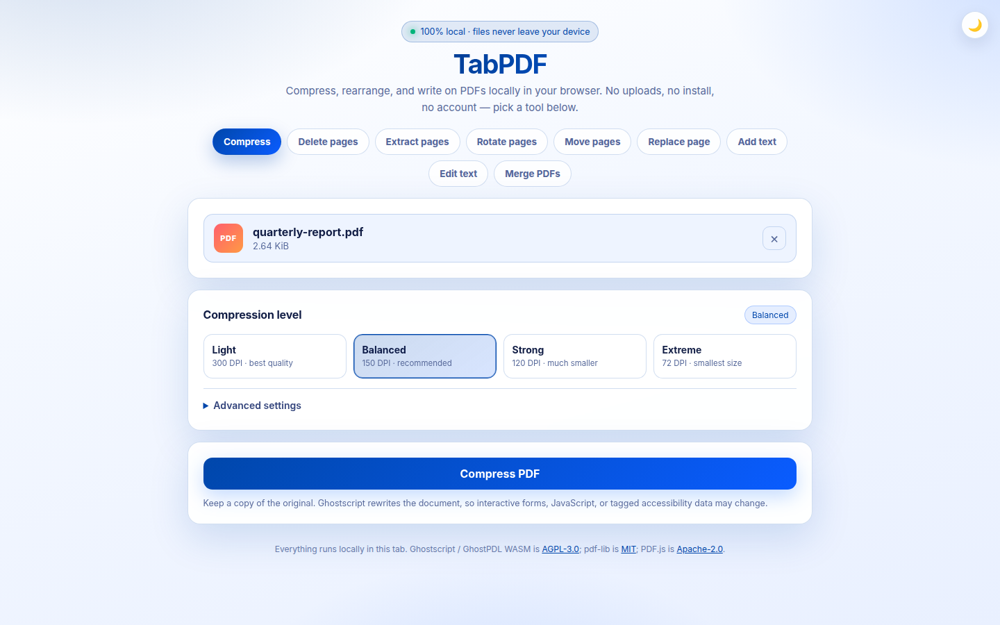
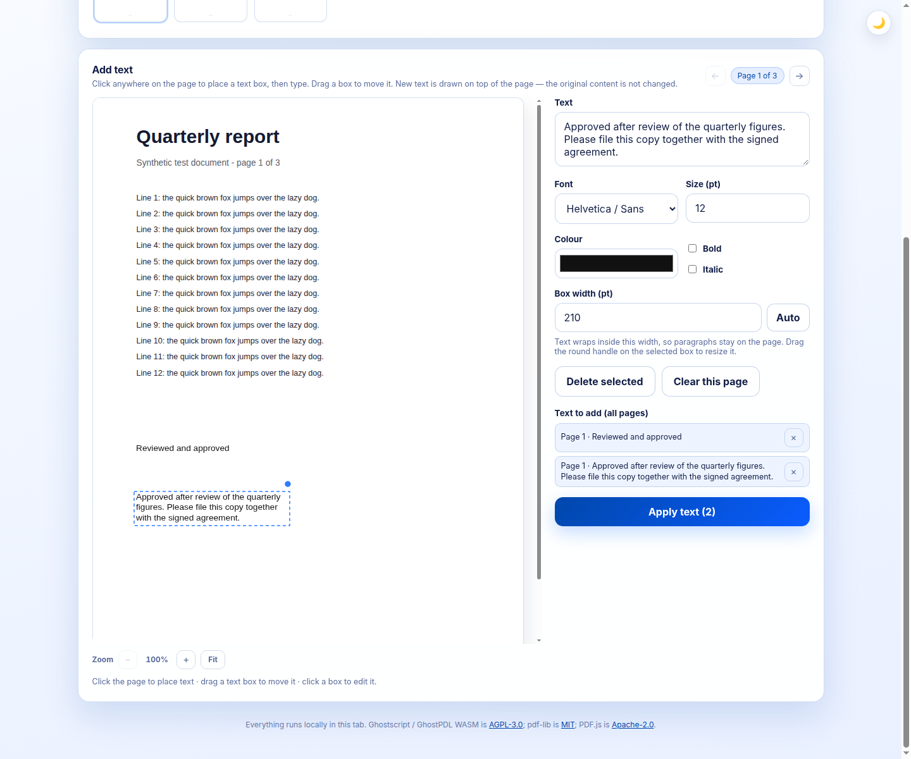
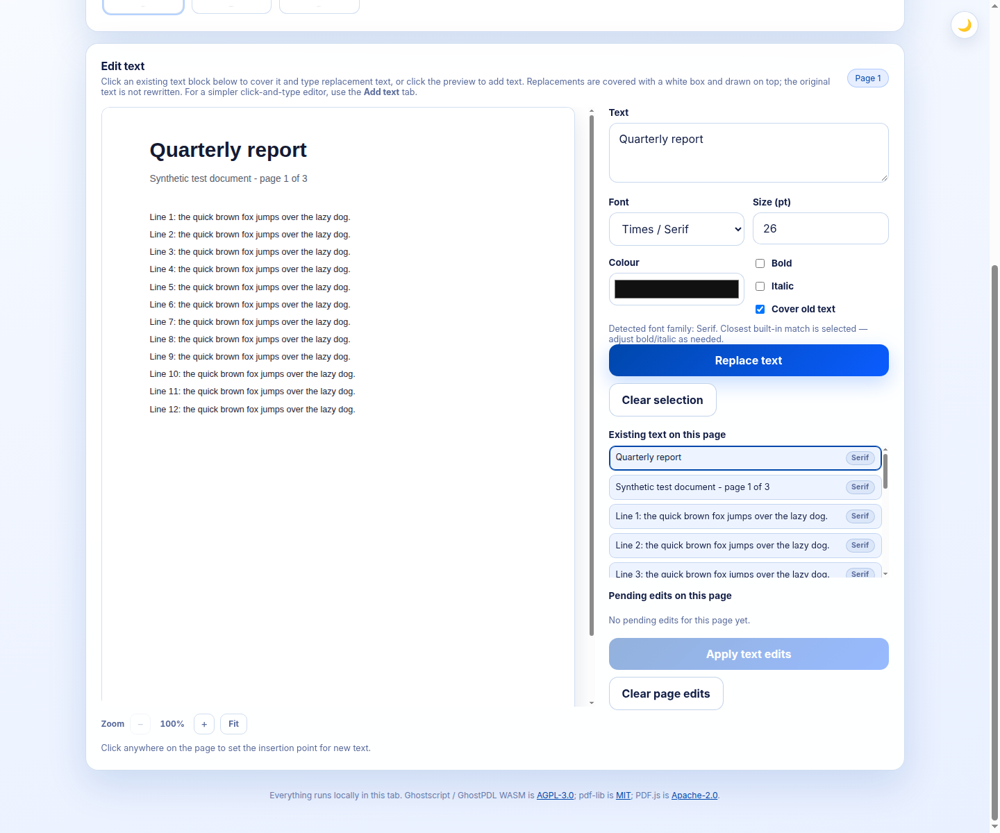
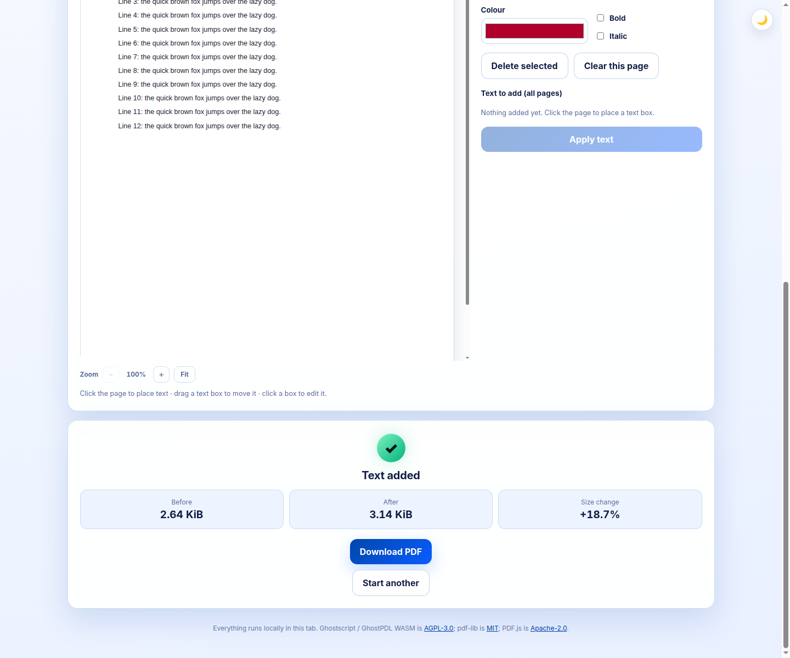

# TabPDF

**A private PDF toolkit that runs entirely in your browser.** No uploads, no
installs, no accounts. Compress files, rearrange pages, write new text on top
of a page, replace existing text, and merge PDFs — all from a single local web
page that also works offline once loaded.



| Add text (new) | Edit text (replace) |
| --- | --- |
|  |  |

## Why TabPDF

- **Nothing leaves your machine.** The page is static files plus WebAssembly;
  there is no server-side processing and no network traffic after load.
- **Real compression.** A bundled Ghostscript / GhostPDL WASM build resamples
  images and re-encodes JPEGs properly, not just repackaging the PDF
  (a 95-page report went from **112.4 MiB to 12.1 MiB — 89.2% smaller**).
- **Write on the page.** Click anywhere to drop a text box, type, drag it into
  place, restyle it, and apply. The old content is kept; new text is drawn on
  top. The separate **Edit text** tool covers and replaces existing text.
- **Big pages are clickable.** Both text editors have a zoom bar
  (− / + / Fit) that enlarges the page up to 400% and scrolls it, so small text
  blocks are easy to hit.
- **No build step.** Plain HTML/CSS/JS modules with vendored libraries; serve
  the folder and it runs. Installable as a PWA, or as a desktop launcher.

## Quick start

```bash
git clone https://github.com/nizamani-ag/tabpdf.git
cd tabpdf
./run_web.py
```

That starts a tiny local server and opens `http://127.0.0.1:8765/`. Drop a PDF
onto the page and pick a tool.

> Browsers block ES modules, Web Workers, and WebAssembly from `file://` pages,
> which is why a local server is used. There is nothing to install.

Useful options:

```bash
./run_web.py --no-browser       # just start the server
./run_web.py --port 9000        # preferred port; tries the next 24 if busy
```

The same static files can be deployed to any static host. This repository
includes a GitHub Pages workflow: enable **Settings → Pages → Source: GitHub
Actions**, and every push to `main` publishes the app. Because it uses
relative URLs, it works from a sub-path such as
`https://<user>.github.io/tabpdf/`.

## Tools

| Tab | What it does |
| --- | --- |
| **Compress** | Ghostscript WASM presets + custom DPI/JPEG quality |
| **Delete pages** | Remove selected pages from a PDF |
| **Extract pages** | Keep/reorder selected pages in a new PDF |
| **Rotate pages** | Rotate selected pages 90°, 180°, or 270° |
| **Move pages** | Reorder pages by dragging thumbnails (single pages or multi-select groups) |
| **Replace page** | Swap selected pages for pages from a second PDF |
| **Add text** | Click a page and type new text boxes; drag them into place |
| **Edit text** | Cover and replace text blocks that already exist in the PDF |
| **Merge PDFs** | Combine multiple PDFs, with reorder arrows |

Page tools open a thumbnail gallery after you choose a PDF. Click pages to
select them; use the toolbar for **All**, **Odd**, **Even**, **Invert**, and
**Clear**:

- **Delete pages** marks pages for removal.
- **Extract pages** keeps pages in the order you click them (the badge shows
  the output order), so clicking `3` then `1` reorders too.
- **Rotate pages** applies a chosen angle to the selected pages.
- **Move pages** turns the gallery into a drag-and-drop surface: drag a page
  between two others to reorder it, or click several pages first and drag them
  as a group. The &larr; / &rarr; buttons nudge the selection one slot, and
  **Reset order** restores the original sequence.
- **Replace page** removes the selected pages and inserts chosen pages from a
  second PDF at the first selected position.
- **Add text** opens a page editor for writing new text on top of the PDF:
  click anywhere on the page to drop a text box, type in the side panel, and
  drag the box to move it. Every box has a **width**: paragraphs wrap inside
  it, and boxes are clamped to the page, so text can never run past the page
  edge. Resize the selected box by dragging the round handle on its right
  edge, type a **Box width**, or press **Auto** to wrap to the page. You can
  add several boxes, restyle the selected one (font, size, colour, bold,
  italic), jump between pages with the &larr; / &rarr; buttons, and remove
  individual boxes or clear a page. Only boxes with text are written to the
  PDF.
- **Edit text** opens a page editor for text that already exists: click a text
  block below the preview to cover it with a white box and draw replacement
  text. Replacements wrap to the width of the covered block. The original text is not rewritten, so text extraction from the
  underlying page may still contain the old string.
- Both text editors have a **Zoom** bar under the preview: **−** / **+** /
  **Fit**. Use it when the page is too small to click accurately; the page
  enlarges up to 400% and the preview scrolls, while clicks still map to the
  right spot.

The default look is a bright cobalt-blue theme. Use the moon/sun button in the
top-right corner to switch to dark mode; the choice is remembered in
`localStorage`.

### Applying changes



Every tool produces a new PDF for download; the chosen file is never changed
in place. Tools that don't aim to shrink the file (page edits, adding text)
show a neutral **Size change** figure instead of a misleading "saved"
percentage.

## Desktop launcher and PWA

An app icon is included in [icon.svg](icon.svg) and [icons/](icons/), with a
launcher that starts the server if needed and opens the browser:

```bash
./launch_tabpdf.py
```

To install it in the application menu and on the desktop:

```bash
./install_desktop.py
```

That installs the icon set into `~/.local/share/icons/hicolor/`, writes
`~/.local/share/applications/tabpdf.desktop`, and creates `~/Desktop/TabPDF.desktop`
when your desktop folder is writable. If your home directory is read-only, run
the installer from a normally writable desktop session.

In Chrome or Edge you can also install the page as an app: open
`http://127.0.0.1:8765/`, click the **Install** icon in the address bar, and
choose **Install**. That creates an app window using the same icon artwork,
without needing `install_desktop.py`.

## Tests

The text editors have an end-to-end browser test that drives the real UI in
headless Chrome and checks the generated PDF:

```bash
./tests/run_e2e.sh
```

The script starts a local server (if one is not already running) and a headless
Chrome, generates a synthetic three-page fixture with
`tests/make_fixture.mjs`, then verifies:

- placing and dragging text boxes, including while zoomed in,
- font / size / colour / bold styling and multi-line text,
- deleting text boxes and applying the result to a new PDF,
- the **Edit text** cover-and-replace flow,
- the zoom controls on both editors,
- that the page sent the expected PDF coordinates to the worker,
- there are no browser console errors.

Generated PDFs live in `tests/fixtures/` and `tests/.artifacts/` and are
gitignored: the test never requires a real document. Set `APP_URL`, `CDP_URL`,
or `CHROME` to point the test at a different server, Chrome, or binary. The
same suite runs on every push in
[.github/workflows/tests.yml](.github/workflows/tests.yml).

## Command-line tool

For batch compression there is also `pdfcompress.py`. It requires
**Ghostscript** for lossy compression and **mutool** or **qpdf** for lossless
optimisation:

```bash
# Debian / Ubuntu
sudo apt install ghostscript mupdf-tools qpdf

# macOS
brew install ghostscript mupdf qpdf
```

Usage:

```bash
./pdfcompress.py input.pdf                       # balanced (default)
./pdfcompress.py input.pdf -o smaller.pdf
./pdfcompress.py input.pdf --preset strong
./pdfcompress.py input.pdf --dpi 150 --jpeg-quality 70
./pdfcompress.py *.pdf -o compressed/            # batch output directory
./pdfcompress.py input.pdf --preset lossless     # no image resampling
./pdfcompress.py input.pdf --dry-run             # show the command only
```

Presets:

| Preset | Images | Best for |
| --- | --- | --- |
| `light` | 300 DPI, JPEG 85 | printing / high-quality archive |
| `balanced` | 150 DPI, JPEG 75 | email, web, screen reading (default) |
| `strong` | 120 DPI, JPEG 60 | much smaller files, softer images |
| `extreme` | 72 DPI, JPEG 40 | smallest size |
| `lossless` | untouched | text/document structure only |

## Notes and limits

- **Privacy:** `*.pdf` is gitignored on purpose. Never commit personal or
  confidential documents; the test suite generates its own synthetic fixture.
- Lossy compression is irreversible: keep the original file.
- Compression rewrites the whole PDF. Interactive forms, JavaScript, tagged
  accessibility data, and some annotations may change; use `--preset lossless`
  or the non-compress tools if those matter.
- Page editing and merging rewrite the PDF with pdf-lib; bookmarks, links,
  named destinations, and form fields may not be preserved.
- Text added or replaced by the text tools uses the built-in PDF fonts
  (Helvetica, Times, Courier, with bold/italic), which cover Latin text.
  Unsupported characters (for example CJK scripts) cannot be written with
  these fonts.
- A very large PDF can take 30–60 seconds to compress and use substantial
  browser memory; page edits are usually much faster.

## Project layout

```text
index.html               the whole UI (markup + CSS)
app.js                   app state, galleries, text editors, zoom, workers
pdfcompress-worker.js    Ghostscript WASM worker
pdfedit-worker.js        pdf-lib page/text worker
run_web.py               tiny local static server
launch_tabpdf.py         start the server and open the browser
install_desktop.py       install icon + desktop entry
pdfcompress.py           command-line compressor
tests/                   synthetic fixture + headless-browser E2E suite
vendor/                  pinned pdf-lib, PDF.js and Ghostscript WASM
docs/screenshots/        README screenshots (synthetic document)
```

## Licenses

TabPDF itself is distributed under the **GNU Affero General Public License
v3.0** — see [LICENSE](LICENSE). This is required because the app bundles
Ghostscript / GhostPDL (AGPL-3.0); running a modified version as a network
service therefore also requires offering its source, which a public repository
provides.

Bundled libraries:

- Ghostscript / GhostPDL WASM — **AGPL-3.0**. See
  [vendor/ghostpdl/LICENSE](vendor/ghostpdl/LICENSE) and
  [vendor/ghostpdl/README.md](vendor/ghostpdl/README.md).
- pdf-lib — **MIT**. See [vendor/pdf-lib/LICENSE.md](vendor/pdf-lib/LICENSE.md).
- PDF.js — **Apache-2.0**. See [vendor/pdfjs/LICENSE](vendor/pdfjs/LICENSE).
